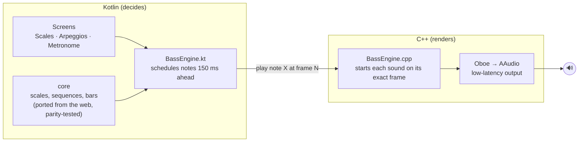
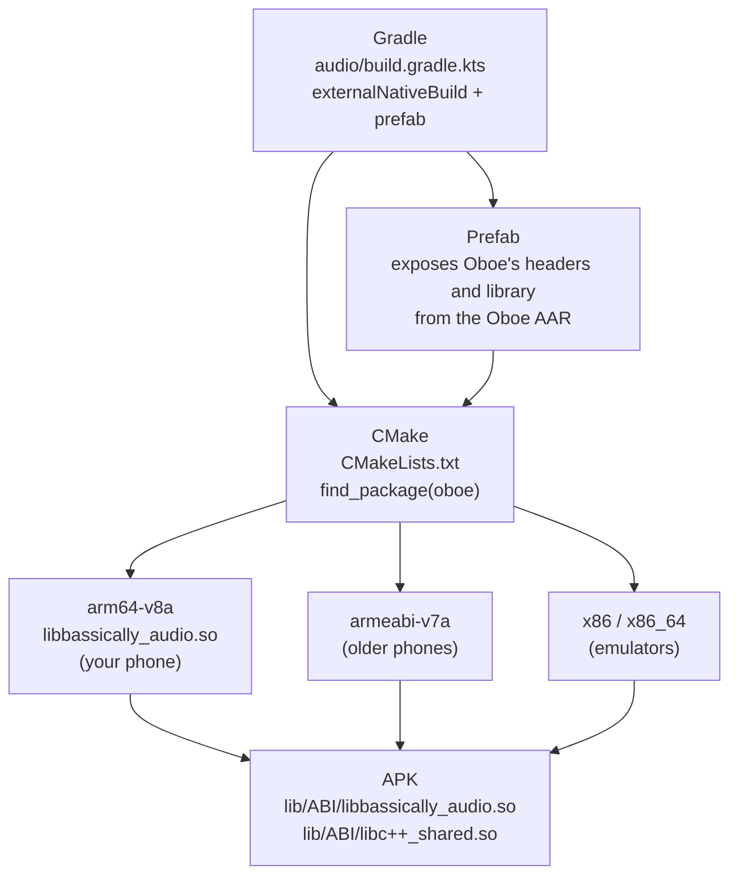
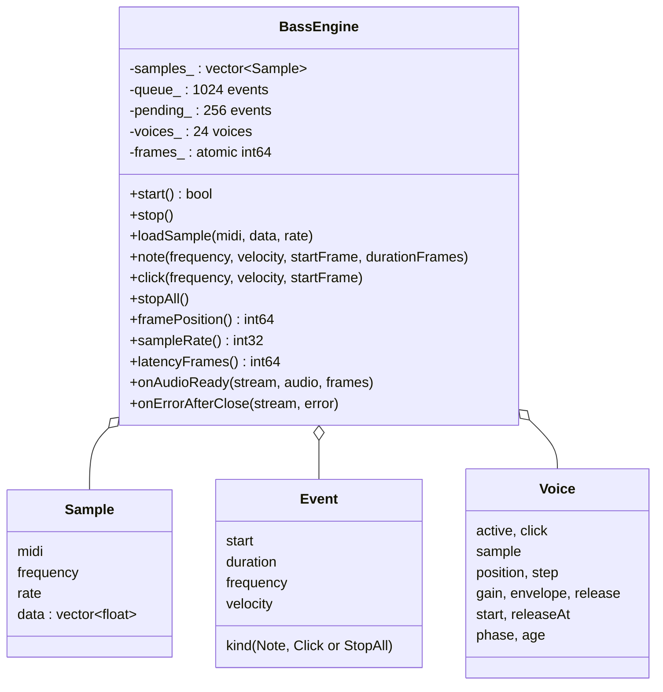
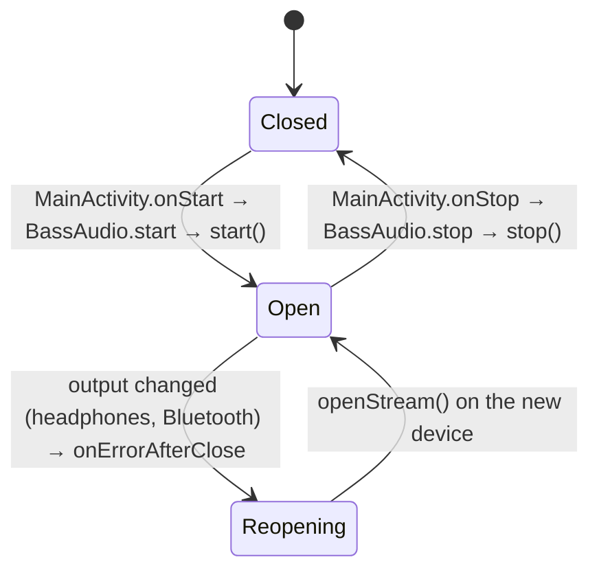
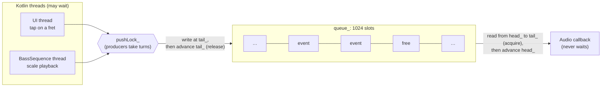
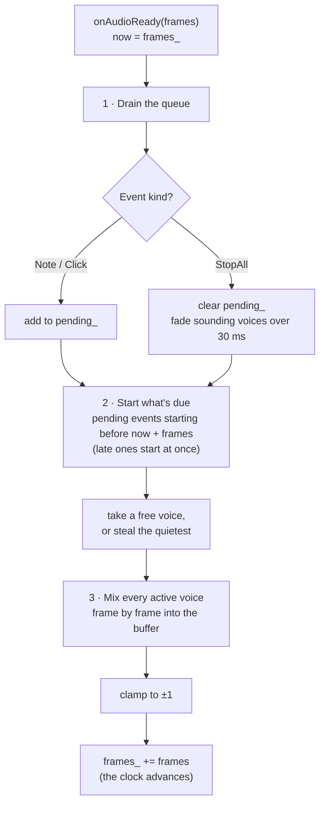
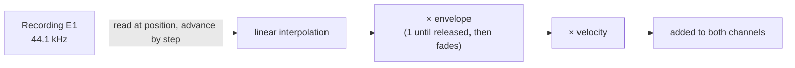
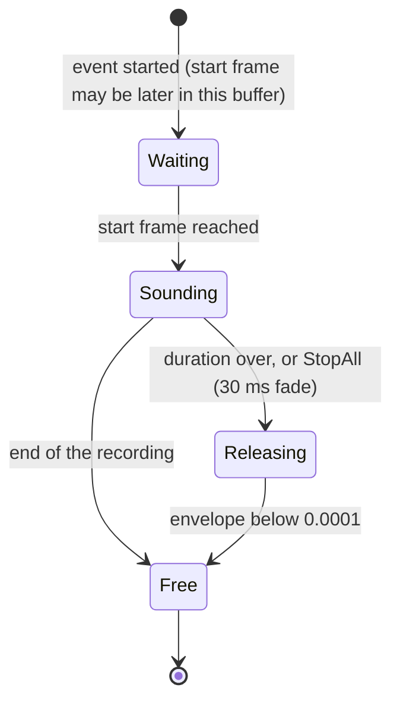
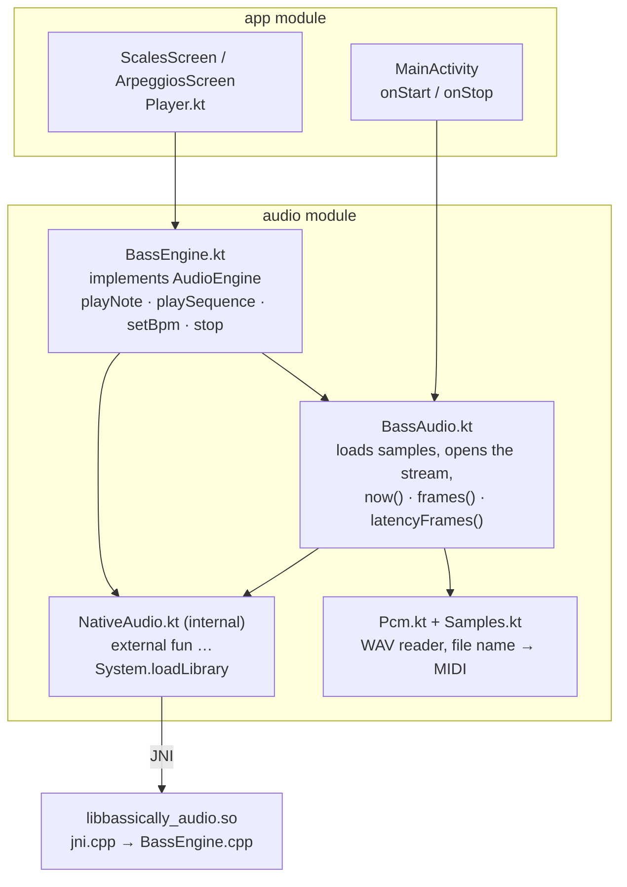
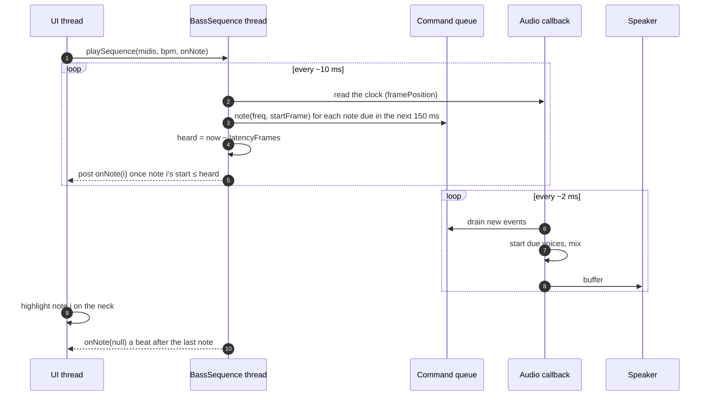

# The Android audio engine

How Bassically plays the recorded bass and the metronome click on Android: the architecture and the reasoning behind it, the libraries, a walk through the C++ code, and how Kotlin drives it.

The code lives in [`android/audio/`](../android/audio):

| File                                                                                                                                                                                       | Lines | Role                                                       |
| ------------------------------------------------------------------------------------------------------------------------------------------------------------------------------------------ | ----: | ---------------------------------------------------------- |
| [`src/main/cpp/BassEngine.h`](../android/audio/src/main/cpp/BassEngine.h)                                                                                                                  |   101 | The engine class and its data structures                   |
| [`src/main/cpp/BassEngine.cpp`](../android/audio/src/main/cpp/BassEngine.cpp)                                                                                                              |   244 | Stream setup, the command queue, the sampler and the click |
| [`src/main/cpp/jni.cpp`](../android/audio/src/main/cpp/jni.cpp)                                                                                                                            |    54 | The bridge Kotlin calls into                               |
| [`src/main/cpp/CMakeLists.txt`](../android/audio/src/main/cpp/CMakeLists.txt)                                                                                                              |    12 | The native build                                           |
| [`NativeAudio.kt`](../android/audio/src/main/kotlin/com/perceptronics/musicteacher/audio/NativeAudio.kt)                                                                                   |       | Kotlin declarations of the native functions                |
| [`BassAudio.kt`](../android/audio/src/main/kotlin/com/perceptronics/musicteacher/audio/BassAudio.kt)                                                                                       |       | Loads the samples, opens and closes the stream             |
| [`BassEngine.kt`](../android/audio/src/main/kotlin/com/perceptronics/musicteacher/audio/BassEngine.kt)                                                                                     |       | Notes and sequences: the API the screens use               |
| [`Pcm.kt`](../android/audio/src/main/kotlin/com/perceptronics/musicteacher/audio/Pcm.kt), [`Samples.kt`](../android/audio/src/main/kotlin/com/perceptronics/musicteacher/audio/Samples.kt) |       | Reading the WAV files and naming them by MIDI note         |

---

## 1. The big idea: a smart scheduler and an exact renderer

Playing music on time takes two different skills:

1. **Deciding what to play and when**: which notes make up the scale, how fast, in what order, whether to loop.
2. **Producing the sound at exactly the right moment**, to the individual audio sample.

The engine gives each job to the language that is good at it, just as the web app does.



| Job                      | Web app                 | Android app                       |
| ------------------------ | ----------------------- | --------------------------------- |
| Decide _what_ and _when_ | TypeScript + Tone.js    | Kotlin (`BassEngine.kt` + `core`) |
| Render sound exactly     | The browser's Web Audio | C++ (`BassEngine.cpp` on Oboe)    |

**Why split it this way?**

- **The music logic stays in one tested place.** Scales, play sequences and (from Phase 5) metronome bars come from `core`, which is checked value by value against the web app. A sequencer written in C++ would be a third copy of that logic with no parity tests.
- **The C++ side stays small.** It understands only three commands: _start this note at frame N_, _start a click at frame N_, _stop everything_. Little code means little to get wrong in the one place where a mistake is audible.
- **Timing comes from the audio clock, not from a timer.** See the next section.

### Two clocks

Threads and timers on a phone are imprecise: a thread asked to wake up in 10 ms may wake up after 14. If notes were started directly from such a timer, you would hear the jitter.

Instead the engine uses the "two clocks" pattern (the web metronome uses it too):

- A **Kotlin thread** wakes up roughly every 10 ms. Each time, it looks **150 ms ahead** and schedules every note that falls in that window, stamped with an exact **frame number** on the audio clock.
- The **audio thread** starts each sound on exactly that frame.

A late wake-up doesn't matter, because the notes were already handed over well before they are due.

```text
time (ms)     0    10    24    30          120                          787
              │    │     │     │            │                            │
Kotlin ticks  ●    ●     ●     ●   ...      │                            │
                         └ due at 20 ms, woke 4 ms late: harmless       │
audio clock   ──────────────────────────────◆────────────────────────────◆──▶
                                         note 1                       note 2
                                     frame 5760 at 48 kHz          one beat later (90 BPM)
              note 1 was handed over at the 0 ms tick (it was within 150 ms),
              note 2 at the tick around 640 ms; each plays on its exact frame.
```

One frame is one sample per channel: at 48 kHz, a frame lasts about 0.02 ms.

### Why C++ at all?

1. **Latency.** Android's fastest audio path, AAudio with direct "MMAP" access to the hardware, is a native API. On the Galaxy S24 the app got 2 ms buffers, about as small as Android offers.
2. **No garbage collection.** The audio callback must deliver a buffer every couple of milliseconds. A Kotlin garbage-collection pause at the wrong moment would be heard as a click or a gap. C++ has no garbage collector.
3. **The tuner.** Phase 6 needs an _unprocessed_ microphone (no automatic gain, no noise suppression), which Oboe exposes cleanly.

---

## 2. Libraries and toolchain

| Piece             | What it is                                                       | Why                                                                                                                                                                                                        |
| ----------------- | ---------------------------------------------------------------- | ---------------------------------------------------------------------------------------------------------------------------------------------------------------------------------------------------------- |
| **Oboe 1.11**     | Google's open-source C++ audio library                           | Wraps Android's two native audio APIs: **AAudio** (Android 8.1+) and **OpenSL ES** (Android 8.0). Our minimum is Android 8.0, so we'd otherwise need both. It also handles device quirks and reconnection. |
| **NDK 30**        | Google's toolchain for compiling C and C++ for Android           | Compiles the engine                                                                                                                                                                                        |
| **CMake 4.1**     | The C++ build system                                             | Describes the native library (`CMakeLists.txt`)                                                                                                                                                            |
| **Prefab**        | A way to ship native libraries inside normal Gradle dependencies | `com.google.oboe:oboe` arrives like any other dependency, with headers and binaries inside                                                                                                                 |
| **`c++_shared`**  | The C++ standard library, linked as a shared library             | Oboe uses it too; two copies of the standard library in one app cause subtle bugs                                                                                                                          |
| `-O3 -ffast-math` | Compiler flags                                                   | Maximum optimization; lets the compiler reorder float math, harmless for audio                                                                                                                             |

### How it's built



CMake runs once per CPU type, and every result goes into the APK. That's part of why the debug APK is about 65 MB. A release build is much smaller: Google Play delivers only the phone's own CPU type, without debug symbols.

---

## 3. The C++ code

### 3.1 The class (`BassEngine.h`)

`BassEngine` implements two Oboe interfaces:

- `AudioStreamDataCallback`: Oboe calls **`onAudioReady()`** on its real-time audio thread whenever it needs the next buffer of sound.
- `AudioStreamErrorCallback`: Oboe calls **`onErrorAfterClose()`** when the stream dies, for example when headphones are plugged in.



- **`Sample`**: one recording, holding its MIDI note, its frequency, its sample rate (44.1 kHz) and the audio itself as floats from −1 to 1 (mono).
- **`Event`**: a command from Kotlin.
- **`Voice`**: a sound currently playing: which sample, where in it (`position`), how fast it moves through it (`step`, which sets the pitch), and its volume envelope. 24 voices means up to 24 overlapping sounds.
- **`frames_`**: the engine's own clock, counted in frames. It's atomic so any thread can read it safely.

### 3.2 Opening the stream

```cpp
builder.setDirection(oboe::Direction::Output)
    ->setPerformanceMode(oboe::PerformanceMode::LowLatency)  // the fast path
    ->setSharingMode(oboe::SharingMode::Exclusive)           // direct (MMAP) hardware access
    ->setFormat(oboe::AudioFormat::Float)                    // mix in floats, no conversion
    ->setChannelCount(oboe::ChannelCount::Stereo)
    ->setUsage(oboe::Usage::Media)
    ->setContentType(oboe::ContentType::Music)
    ->setDataCallback(this)
    ->setErrorCallback(this);
...
stream_->setBufferSizeInFrames(stream_->getFramesPerBurst() * 2);
```

A **burst** is the chunk of audio the hardware takes at a time: 96 frames (2 ms) on the S24. A buffer of **two bursts** is the usual sweet spot: one burst playing and one burst of safety margin. Smaller risks glitches; larger adds delay. The phone's log confirmed the result: `got MMAP … perf = LL, burst = 96`.

**Lifecycle:**



- The app holds the audio device **only while it's on screen**, so music apps and calls aren't blocked.
- When the output device changes, the engine simply reopens on the new one. The frame clock **keeps counting** across the restart, so whatever Kotlin already scheduled stays valid.

### 3.3 The lock-free command queue

The one unbreakable rule of real-time audio: **the audio thread must never wait.** It must not:

- take a lock that another thread might hold (if that thread is paused, the audio stalls and you hear a click);
- allocate memory, read files, or call into Java or Kotlin.

So commands travel through a **ring buffer** of 1024 slots:



- A **producer** writes the event into the slot at `tail_`, then advances `tail_` with a _release_ store.
- The **consumer** (the audio callback, and only it) reads `tail_` with an _acquire_ load, processes every event from `head_` up to it, then advances `head_`.
- The release/acquire pair is a C++ memory-ordering guarantee: once the audio thread sees the new `tail_`, it is guaranteed to also see the event written before it. No lock is needed between the two sides.
- Several Kotlin threads can produce (the UI and the sequence thread), so they take turns on `pushLock_`. That lock is only ever held by Kotlin-side threads, never by the audio thread.

### 3.4 The audio callback: every 2 ms

`onAudioReady()` runs about 500 times a second. Each call fills one buffer in three steps.



#### The sampler: how a note gets its pitch

There's one recording every 3 semitones, so any note is at most 1.5 semitones from a recording. `nearestSample()` picks the closest. On a tie it picks the higher recording and shifts it down, exactly like Tone.Sampler in the web app.

Pitch is changed by **playback speed**: play a recording 6% faster and it sounds a semitone higher. One number, `step`, combines the pitch shift and the conversion from the recordings' 44.1 kHz to the phone's 48 kHz:

```
step = (wanted frequency / recorded frequency) × (44100 / 48000)
```

Example: an F1 played from the E1 recording (one semitone up) on a 48 kHz phone:

```
step = 1.0595 × 0.91875 ≈ 0.9734 recording frames per output frame
```

Each output frame, `position` advances by `step`. It usually lands between two recorded samples, so the engine **interpolates linearly** between the neighbors:

```
value = a + frac × (b − a)        // a, b = samples either side, frac = the fractional part of position
```



#### The envelope: how a note ends

A note sounds at full volume until its duration is up. Then every frame the envelope is multiplied by a constant just below 1, an exponential fade that reaches −60 dB after **0.3 s** (the web sampler's release). Below 0.0001 the voice is freed. The fade constant is

```
release = e^( ln(0.001) / (0.3 s × sample rate) )      ≈ 0.99952 at 48 kHz
```



#### The click: the metronome voice

The click isn't a recording. It's synthesized, matching the web metronome's triangle synth:

- a **triangle wave** from a phase that runs 0→1 at the click's pitch: `4·|phase − 0.5| − 1`;
- a **1 ms** linear fade-in (so it doesn't pop), then an exponential decay with a 12 ms time constant;
- **80 ms** long at most.

#### Final touches

Every voice is added to both stereo channels. The sum is **clamped to ±1** so heavy overlaps can't overflow. Finally `frames_` advances by exactly the number of frames rendered: that's the clock Kotlin schedules against.

### 3.5 The JNI bridge (`jni.cpp`)

**JNI** (Java Native Interface) is how JVM languages call C and C++. The bridge holds one engine for the whole app and nine small functions:

```cpp
namespace { BassEngine engine; }

extern "C" JNIEXPORT void JNICALL
Java_com_perceptronics_musicteacher_audio_NativeAudio_note(JNIEnv *, jobject, jdouble frequency,
                                                           jfloat velocity, jlong startFrame, jlong durationFrames) {
    engine.note(frequency, velocity, startFrame, durationFrames);
}
```

- The long function name is the **JNI naming convention**: `Java_` + package + class + method. It's what the JVM looks up when Kotlin calls `NativeAudio.note(...)`.
- `extern "C"` stops the C++ compiler from changing ("mangling") the names, so the JVM can find them.
- JNI types map directly: `jdouble` = `Double`, `jfloat` = `Float`, `jlong` = `Long`.
- `loadSample` is the only one that does real work: it copies the Kotlin `FloatArray` into a C++ vector with `GetFloatArrayRegion`, once per sample at startup.

---

## 4. The Kotlin side



- **`NativeAudio.kt`** declares the native functions with `external fun`, Kotlin's way of saying "implemented in native code". `System.loadLibrary("bassically_audio")` runs in the object's `init`, so the library loads the first time it's used. It's `internal`: the rest of the app never calls it directly.
- **`BassAudio.kt`** owns the device for the whole app, on a single background thread so the screen never freezes. The first time it starts, it reads the 10 WAV files from the APK's assets (`Pcm.kt` decodes them and mixes to mono, `Samples.kt` turns `As1.wav` into MIDI 34) and hands them to C++. Then it opens the stream. It also converts seconds to frames.
- **`BassEngine.kt`** implements the same `AudioEngine` interface as the web app, so screens only ever call `playNote`, `playSequence`, `setBpm` and `stop`.

### 4.1 Four threads

| Thread                | Who creates it       | What it does                                        | May it wait? |
| --------------------- | -------------------- | --------------------------------------------------- | ------------ |
| **UI (main)**         | Android              | Draws the screens; a tap on a fret calls `playNote` | Briefly      |
| **BassAudio**         | `BassAudio.kt`       | Loads samples, opens and closes the stream          | Yes          |
| **BassSequence**      | `BassEngine.kt`      | Schedules a scale or arpeggio ahead of time         | Yes          |
| **Oboe audio thread** | Oboe (high priority) | `onAudioReady`: renders sound                       | **Never**    |

### 4.2 Playing a scale, step by step



- **One note per beat:** a beat lasts `60 / BPM` seconds, and each note sounds for half a beat.
- **"Heard" time:** a frame takes a little while to travel from the engine to your ears (the output latency, which Oboe estimates). The sequence thread tells the screen about a note only when its start time minus that latency has passed. That's why the yellow highlight on the neck matches what you hear instead of running ahead of it.
- **`setBpm`** just updates a variable; the next note scheduled uses the new beat length, so tempo changes apply while playing.
- **`stop()`** increments a generation counter. The sequence thread notices and exits, any late updates from the old run are ignored, and C++ receives `StopAll`.

### 4.3 Tapping a fret

The simplest path: `playNote(midi)` → `NativeAudio.note(frequency, 1, now, 0.25 s)` → into the queue → the next audio callback (within about 2 ms) starts the voice.

---

## 5. Known limitations and possible improvements

None of these affect how it sounds today.

1. **Samples must be loaded before the stream starts.** The audio thread keeps direct pointers into the sample list, which could move in memory if more samples were added later. `BassAudio` guarantees the order, but the engine itself doesn't enforce it. Worth hardening if samples ever become switchable.
2. **Two warning logs inside the audio callback** (queue full, too many pending sounds). Logging isn't strictly real-time-safe. They only fire in overload situations that shouldn't happen, but they could move out of the callback.
3. **Clamping is a hard limiter.** Many loud overlapping notes would distort rather than compress. Irrelevant for single bass notes; a soft limiter would help if chords are ever played.
4. **Linear interpolation** is the simplest way to resample. With shifts of at most 1.5 semitones it's inaudible on bass, but a higher-quality interpolator is an easy upgrade.

---

## 6. What comes next

- **Phase 5, Metronome:** the scheduler runs the ported `barPlan`/`buildBar` and pushes `click` and bass `note` events through the same queue. The beat lights use the same "heard time" idea as the scale highlight.
- **Phase 6, Tuner:** an Oboe _input_ stream with the `Unprocessed` microphone preset feeds the ported YIN pitch detector.

See [`ANDROID.md`](ANDROID.md) for the full plan and [`android/README.md`](../android/README.md) for build commands.
